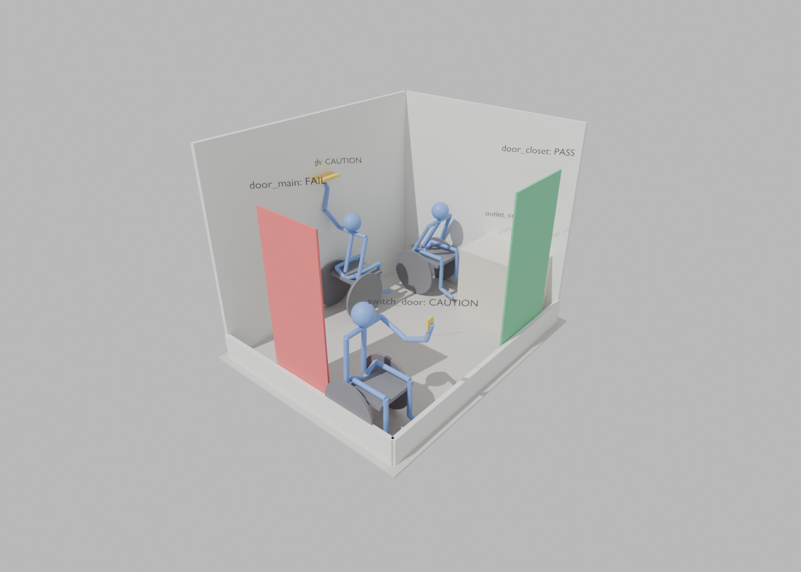

# AccessPath Verifier

Tests a floor plan against avatars of people with mobility and functional limitations, so you can check whether a design is actually usable before it's built. Can this person reach the outlet? Clear the doorway?

Each avatar is built from **joint cards** (baseline range of motion plus condition-specific overrides), not from one hand-made model per diagnosis. See [the build brief](docs/AccessPath_Verifier_Build_Brief.docx) for the design, and [the conventions](docs/conventions.md) for how its joint names, axes and angles map to the ISB and ISNCSCI standards when moving data to other software.

**[▶ Watch the 70-second demo video](docs/AccessPath_demo.mp4)**



*Test bathroom, profile `stroke_R_moderate_wheelchair`. Each fixture is colored by its result, and the avatar is posed in the reach the verifier found. The 30 in door fails the ADA 32 in minimum. The shelf is reachable by this avatar, but only about 5% of measured wheelchair users could reach it, so it gets a CAUTION. (This picture is from before that check was added, when the switch was also CAUTION.)*

## Where each step of the brief stands

| Step | Status | Where |
|---|---|---|
| 1. Baseline rig | Done. Blender skeleton with one bone per card joint, named to match the cards, baseline limits applied | `blender/rig.py`, `blender/build_rig.py` |
| 2. Card library | Done. The spreadsheet is the source of truth; editing one row changes the results, with no rig changes | `data/card_library.xlsx`, `accesspath/cards.py` |
| 3. Profile composer | Done. A profile name produces a constrained copy of the rig | `accesspath/profiles.py`, `blender/apply_profile.py` |
| 4. Envelope generation | Done for the arm chain (trunk lean, shoulder, elbow, wrist) using IKPy. Point cloud exports as `.ply` | `accesspath/kinematics.py` |
| 5. Task chain | Done. 5 tasks: outlet, light switch, shelf, doorway, knee space under a sink or counter | `data/tasks.json` |
| 6. Floor-plan test | Done for a JSON room, viewable in Blender. **AutoCAD/DXF import is not built yet.** | `accesspath/verify.py`, `blender/show_results.py` |

The Blender skeleton and the IKPy reach chain are tested against each other: for the same joint angles they put the fingertip in the same place, to 0.1 mm.

## Results

| Result | Meaning |
|---|---|
| **PASS** | The avatar can do it, using only sourced or interpolated data |
| **CAUTION** | The avatar can do it, but measured data says many real people in this group can't. For wheelchair profiles: fewer than 75% of the IDeA Center's measured manual wheelchair users could reach that spot (`data/idea_reach.json`); a door narrower than the widest 5% of measured users with their chair; or knee space that fits a typical user's knees but not the tallest (see below) |
| **UNVERIFIED** | The avatar can do it only because able-bodied values stood in for data that isn't sourced yet. The real answer may be FAIL |
| **FAIL** | The avatar can't do it, even with able-bodied values standing in for missing data |

The verifier tries both arms and every approach the fixture allows (facing the wall, or side-on). Arms backed by real data are tried first. A stroke avatar whose affected arm has gaps can still PASS using the unaffected arm, and the result says which arm it used.

## Running it

Needs Python 3.10+.

```
pip install -e ".[test]"
python -m accesspath check-cards                      # check the spreadsheet, list what still needs a source
python -m accesspath check-avatar                     # the seated avatar's shoulder vs measured wheelchair users
python -m accesspath verify                           # every profile x task in the test bathroom
python -m accesspath verify --profile kafo_L -o out/results.json
python -m accesspath compose stroke_R_moderate        # the joint limits a profile ends up with
python -m accesspath envelope stroke_R_severe --arm R -o out/envelope.ply
pytest                                                # 107 tests, ~2 min
```

### In Blender (tested with Blender 5.0)

```
python -m accesspath compose baseline_standing -o out/baseline_standing.json
python -m accesspath compose stroke_R_moderate_wheelchair -o out/stroke.json
python -m accesspath verify --profile stroke_R_moderate_wheelchair -o out/results.json

blender --background --python blender/build_rig.py -- --profile out/baseline_standing.json --out out/avatar.blend
blender out/avatar.blend --background --python blender/apply_profile.py -- --profile out/stroke.json
blender out/avatar.blend --python blender/show_results.py -- --room data/rooms/test_bathroom.json \
    --results out/results.json --profile stroke_R_moderate_wheelchair
```

Add `--render out/view.png` to the last command to save a still image like the one above. An imported `envelope.ply` lines up with the rig, since both use the same frame: metres, origin on the floor under the hip, +X right, +Y forward, +Z up.

## Moving data to other software

[docs/conventions.md](docs/conventions.md) maps the verifier's names and numbers onto two standards:
- **ISB joint-angle standard (Wu et al. 2005):** axes, signs and rotation order. OpenSim and motion capture use it.
- **ISNCSCI:** how clinicians describe a spinal cord injury.

In practice:
- Every card has an `ISB_term`.
- `accesspath.isb` converts positions and shoulder angles to the ISB frame.
- Spinal cord injury profiles are named the clinical way, e.g. `SCI_C6_AIS_A`.

## Privacy

The engine never sees who a person is: only numbers about a body and a room, under a random client code. Identifying fields (names, birthdates, addresses, diagnoses and similar) are rejected wherever they would enter. See [docs/privacy.md](docs/privacy.md).

## Checking reach against measured wheelchair users

The avatar answers "can this person reach it?". For wheelchair profiles the verifier also asks "how many real wheelchair users could?", using the IDeA Center's measurements of 235 manual wheelchair users (Design Resource #20, University at Buffalo, funded by the U.S. Access Board), copied cell by cell into `data/idea_reach.json`.

- Each reach result records `population_pct`: the share who could reach that spot, using the approach most of them could manage (from the side or straight ahead).
- It's the cautious reading: the 41 of 276 people who couldn't reach above shoulder height weren't measured, and are counted as unable. Between chart cells, the farther cell is used.
- An avatar PASS becomes CAUTION when that share is under 75%, the study's own line for good design, or when the target is below 16 in (not measured; the study recommends 28 in as a low limit).
- The data is for manual chairs and a light object. Power chairs and scooters reach less straight ahead (D'Souza et al., RESNA 2009), so treat these figures as a best case for them.

## Checking size against measured wheelchair users

`data/wheelchair_size.json` holds a few values from Paquet & Feathers (2004): 121 U.S. wheelchair users measured seated in their own chairs, manual and power (Int J Ind Ergon 33:191-204, Tables 4 and 5).

- **Seated shoulder.** `check-avatar` and a test place the avatar's seated shoulder among them. Every body size tested falls inside the measured 5th-95th percentile range (91.3-114.0 cm). Even the shortest band (4 ft 11 in) puts it at 100.2 cm, right at the median woman (99.6-100.5 cm), so for the shorter half of women in chairs the avatar reaches high. The IDeA check above is what covers them.
- **Doors.** A wheelchair door that meets the ADA 32 in (0.815 m) but is under 0.852 m is CAUTION: about 1 in 20 measured users are wider than that with their chair (95th percentile 85.2 cm for women, 83.9 cm for men; power chairs up to 90.6 cm).
- **Knee space.** The `pull_under` task (wheelchair profiles only) reads a sink or counter's `knee_clearance_m`, the height of the open space underneath. PASS at or above the tallest 95th-percentile seated knee height (74.8 cm); FAIL below the lowest median (61.4 cm); CAUTION between. The ADA's 27 in (685 mm) knee-clearance height lands in CAUTION.
- **Caveats (the authors'):** 46% of the sample used power chairs (about 7% nationally), and it wasn't representative by sex, chair or disability.

## How every number is tracked

Rules added Nov 8, 2026 after a business coach's review, on top of the existing ones.

- **Each card records its source in full.** The `source_type` column says what kind of source it is: study, review quoting a study, textbook or standard. `source_location` gives the page or table where the number appears. `access_license` says how the paper may be used (open access isn't the same as commercially usable). `last_checked` is when a person last opened it, and `independent_sources` counts the sources. `contested_note` records any source that disagrees.
- **Verified means at least 5 independent sources agree** (Heather's rule). A review quoting a study counts as that study, not a new one. A source that disagrees still counts, and makes the card *contested*: the card shows each number instead of averaging them. Today no card is verified yet. `python -m accesspath check-cards` lists which cards are contested, which haven't been re-checked within a year, which have no page or table recorded, and which come from non-commercial or subscription papers.
- **Eyes only.** Cards whose source is subscription-only or non-commercial are kept, never thrown out, but labelled eyes only: the number is cited and nothing from the source is shown to customers. check-cards lists them, and each result's inputs say so (`eyes_only`). Study size (`sample_size`) and who checked it (`checked_by`) are recorded too; under 30 people is flagged as a small study.
- **Every reach result lists the values it rests on** (`inputs` in the JSON output): each joint limit on the arm used, with its card, status and evidence, plus the body height, seat height and trunk lean, marked as estimates where they are.
- **Changelog.** The card library's Changelog sheet records every change to a number or source: date, card, old and new value, the source that triggered it, and who checked it. Old values stay visible.
- **Software and data licences** are logged in [docs/components.md](docs/components.md).

## Editing the card library

Open `data/card_library.xlsx`. The **Field Definitions** sheet explains every column, and **Changes From Original** lists what changed from your first version.

- **To add a citation:** fill in the numbers and source, and set status to `sourced`. Then run `python -m accesspath check-cards`; it will say exactly which row is wrong if something doesn't fit.
- **To make a new profile:** add a row to the **Profiles** sheet listing the condition card_ids it uses.
- **To dial a card within its range:** write `card_id@value` in the profile's card_ids, e.g. `stroke-shoulder-abd-1@60` (that card's band is 45 to 90 degrees). With no `@value`, the cautious edge is used. A value outside the range is rejected.
- **To set a body size:** give the profile a `body_band` (A to D on the **Body Bands** sheet: 4-inch height ranges covering the 5th to 95th percentile of U.S. adults, from CDC data). Reach is then tested at the band's shortest height. A `body_height_in` dials in a measured height within the band; a measured height always beats a band.
- **To use a person's own measurements:** fill any of these Profiles columns, in inches. Each one replaces the height-ratio estimate, so two people of the same height with a long trunk or long legs each get their own shape:
  - `seat_height_in`: floor to the top of the seat cushion, in their own chair
  - `seated_shoulder_in`: seat to the top of the shoulder, sitting upright (the trunk measure; the shoulder, not the head, so head size doesn't hide trunk length)
  - `arm_length_in`: top of the shoulder to the fingertip
  - `knee_height_in`: floor to the top of the kneecap, seated, feet on the footrest. The knee-space check then uses this person's knee instead of population numbers, with a 2 in allowance (an estimate) before it passes.

  A number outside a plausible range (e.g. one entered in centimetres) is rejected. Every result lists which values were measured. The demo profiles `wheelchair_long_trunk` and `wheelchair_short_trunk` are the same height with the same arms; the long trunk reaches 184 cm up a side wall, the short one 176 cm.
- **Leave unsourced numbers empty,** not a dash.
- **`range_kind` tells the verifier how to read the numbers:**
  - Bands (`score_band`: a stroke scoring band, or a study's mean ± 1 SD) use the band's lower edge, so the design has to work for everyone in the band.
  - Task thresholds (`task_threshold`) are recorded but never applied as a joint limit.

## Assumptions to confirm

These are in `data/body.json` and the card library, each marked with where it came from:

- **Body size:**
  - 1.70 m avatar, segment lengths from Drillis & Contini ratios
  - wheelchair hip height 0.57 m
  - seated forward trunk lean capped at 30°
- **Approach distances:** how close the avatar gets to the wall. Standing forward 0.20 m, wheelchair forward 0.60 m (footrests at the wall, no knee space under counters), wheelchair side 0.33 m.
- **Shoulder extension 0–60° and trunk flexion 0–80°:** added from AAOS ranges and marked `interpolated`, since the arm chain needs them.
- **Doorway width with no mobility aid:** shoulder width + 5 cm each side (interpolated).
- **Arm thickness:** the arm's centre line keeps 3.5 cm from walls and counters (estimate, `limb_clearance_m` in `data/body.json`); only the hand touches.
- **Getting there:** a reach counts only if the arm can move from resting to the reach without passing through a wall or counter. The verifier tries the direct move, then "raise the arm forward, then over" paths, and the video animates the path it found.
- **Reach point:** a reach counts when the fingertip touches the target. Legs aren't used, so there's no squatting or stepping.

## Not built yet

- **AutoCAD/DXF room import.** Rooms are JSON for now (`data/rooms/test_bathroom.json`).
- **Leg-chain envelopes.** The doorway check uses a width, not a swept leg.
- **Hallway widths and gait sweep for canes, crutches and walkers.** Door widths for these aids are in (32 in / 815 mm, U.S. Access Board ADAAG Appendix A4.2.1(2)), with crutches flagged CAUTION under 840 mm (a UK estimate). Hallways need 36 in (915 mm) by the same source, but rooms don't have hallways yet.
- **Hand/finger cards.**
- **Using the `strength`, `control` and `dependency_flags` columns.** They're recorded but don't change results yet.
- **Shoulder rotation and forearm pronation/supination cards.**

## Demo video

`video/` builds a ~75 s demo video from real verifier output (no audio; it's meant to be talked over):

```
python -m accesspath verify --profile stroke_R_moderate_wheelchair --profile stroke_R_severe -o out/results.json
python3 video/blender_clip.py -- --blend out/avatar.blend --results out/results.json \
    --profile stroke_R_moderate_wheelchair --out out/frames/clip_ --frames 96
python3 video/make_video.py --clip out/frames/clip_ --out out/AccessPath_demo.mp4
```

Needs `pip install bpy matplotlib pillow imageio-ffmpeg`, and `out/avatar.blend` with the profile's rig (see "In Blender" above).

### Narrated walkthrough (~11 min)

A slower video for someone who wants to see how the tool reaches each answer, not just the answers. It covers:
- the card library
- choosing a person (stroke, right side, moderate, in a wheelchair)
- what those cards change
- the room
- each test, one at a time: every arm and approach the verifier tried, in order, then the result and its source

Words are on screen and spoken, with subtitles.

```
python -m accesspath verify --profile stroke_R_moderate_wheelchair -o out/results.json
python3 video/fill_poses.py out/results.json          # poses for missed tries, for pictures only
python3 video/test_clips.py -- --blend out/avatar.blend --results out/results.json \
    --profile stroke_R_moderate_wheelchair --out out/tests
python3 video/walkthrough.py --voice-model kokoro-v1.0.onnx --voices voices-v1.0.bin \
    --out out/AccessPath_walkthrough.mp4
```

The voice is [Kokoro](https://github.com/thewh1teagle/kokoro-onnx). It needs `pip install kokoro-onnx soundfile` and the two model files from that project's releases. If pip upgrades numpy past 2.0, put it back with `pip install "numpy<2"` for bpy. Add `--speed 1.0` for normal speaking speed; the default is 0.85.
